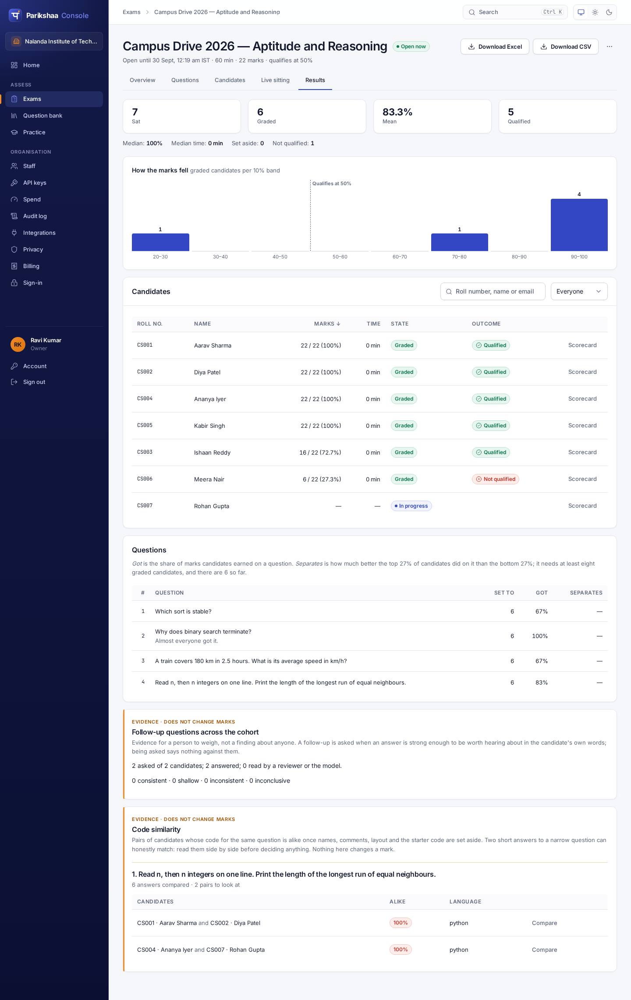

# Design system

Parikshaa has two faces. The **candidate app** is read for an hour at a time,
under some stress, on a lab machine or a phone. The **console** is a working
tool that examiners and invigilators keep open all day. Both are built on one
design system, `packages/brand`, so they read as one product.

Screenshots of every page are in [`docs/screenshots`](screenshots/). They are
taken from the real app over seeded data, not mocked up; see
[Regenerating the screenshots](#regenerating-the-screenshots).



## Principles

- **Calm, not alarming.** Nothing a candidate sees implies suspicion. The
  follow-up question is styled as a question, in the brand's own blue, never in
  warning colours (SPEC §4). Being offline is a quiet amber note, not a red
  error.
- **The grade and the evidence never look alike.** In the console, a score is a
  settled number on a white card. The micro-viva's evidence sits beside it in an
  amber, left-ruled card, with a stated boundary (SPEC §6.1).
- **Dense where it is used all day, generous where it is read under stress.**
  Console body text is 14px; the candidate app's is 16px, with larger touch
  targets.
- **Nothing observed that is not said.** The typefaces are bundled with the
  app. No font, script or image is fetched from a third party at runtime.
- **Accessible by construction.** Every pair of text and background colours
  meets WCAG 2.1 AA. Every control shows a focus ring. The axe checks in
  `packages/e2e/tests/accessibility.spec.ts` run on every change.

## The mark

प, the first letter of परीक्षा, drawn in white on an ink-indigo tile, with a
saffron bindu above its headline. It is `LogoMark` in
`packages/brand/src/react.tsx`. `Wordmark` sets it beside the name, and takes
an optional product name ("Console"). The mark is decorative wherever the name
is beside it, so screen readers read the name once.

## Tokens (`packages/brand/src/tokens.css`)

Components use tokens, never hex values. Dark mode and any later re-theme
change only this file.

| Role | Token | Light | Use |
| --- | --- | --- | --- |
| Primary | `--primary` | `#3346c4` ink indigo | Buttons, links, the current step, focus |
| Accent | `--accent` | `#f28c28` saffron | The bindu, the active nav marker, avatars — sparingly |
| Canvas | `--bg` | `#f6f7fb` | Page background |
| Surface | `--surface` | `#ffffff` | Cards, inputs |
| Text | `--text` / `--text-muted` | `#131a2e` / `#5f687c` | Body / secondary (≥ 4.5:1 on every surface) |
| Success | `--success` | `#12805c` | Saved, graded, verified |
| Warning | `--warning` | `#9a5800` | Evidence, attention, offline |
| Danger | `--danger` | `#c23a2b` | Errors, set aside, failed |
| Chrome | `--chrome` | `#0b1033` | The console sidebar, in both themes |

Status colours are kept apart from the brand colours, so "failed" never looks
like "brand".

- **Type:** Inter (variable, Latin), with Noto Sans Devanagari for Hindi and
  Marathi. The scale runs 12 · 13 · 14 · 16 · 18 · 22 · 28 · 36px.
- **Space:** a 4px grid (`--space-1` … `--space-12`).
- **Shape:** radii of 6, 8, 12 and 16px.
- **Depth:** four shadows, from `--shadow-xs` to `--shadow-lg`.

## Components (`packages/brand/src/base.css`)

Plain elements are styled directly, so every screen is on-brand by default.
Variants are classes:

| Component | Markup |
| --- | --- |
| Button | `<button>` (primary), `.secondary`, `.quiet`, `.danger`, `.large`, `.block`, `.crumb` (reads as a link) |
| Field | `.field` > `label` + `input`/`select`/`textarea`; `.grid` lays fields out in columns |
| Card | `.card`; a `.bar` as its first child becomes the card's header |
| Table | `<table>` with `<thead>`: sticky header, row hover |
| Badge | `.pill`; `.ok`, `.attention`, `.bad`, `.brand`, or `data-state="in_progress"` and the like |
| Figures | `<dl class="figures">` of `div > dt + dd`: a row of headline numbers |
| Messages | `.notice` (muted), `.error`, `.problems` (a list of what is wrong), `.alert` |

Each app adds its own layout on top:

- **Candidate app** (`packages/web/src/styles.css`): the top bar with the clock, question cards, option tiles, the follow-up panel, the section stepper and the receipt.
- **Console** (`packages/console/src/styles.css`): the sidebar shell, sign-in, review, results, live sitting, proctoring and invoices.

## Pages

| | Candidate app | | Console |
| --- | --- | --- | --- |
| 01 | [Access code](screenshots/candidate-01-access-code.png) | 01 | [Sign in](screenshots/console-01-sign-in.png) |
| 02 | [Privacy notice (DPDP)](screenshots/candidate-02-privacy-notice.png) | 02 | [Exams](screenshots/console-02-exams.png) |
| 03 | [Link opened early](screenshots/candidate-03-not-open-yet.png) | 03 | [Exam editor](screenshots/console-03-exam-editor.png) |
| 04 | [Camera notice](screenshots/candidate-04-camera-notice.png) | 04 | [An exam's attempts](screenshots/console-04-exam-attempts.png) |
| 05 | [Camera check](screenshots/candidate-05-camera-check.png) | 05 | [Schedule and invite](screenshots/console-05-invite.png) |
| 06 | [Identity photos](screenshots/candidate-06-identity.png) | 06 | [Results and exports](screenshots/console-06-results.png) |
| 07 | [Answering, with autosave](screenshots/candidate-07-exam.png) | 07 | [Candidate report](screenshots/console-07-candidate-report.png) |
| 08 | [A follow-up question](screenshots/candidate-08-follow-up.png) | 08 | [Review an attempt](screenshots/console-08-review.png) |
| 09 | [In Hindi](screenshots/candidate-09-hindi.png) | 09 | [Live sitting](screenshots/console-09-live.png) |
| 10 | [Leaving a section](screenshots/candidate-10-section-leave.png) | 10 | [Proctoring review](screenshots/console-10-proctoring-review.png) |
| 11 | [A section's own clock](screenshots/candidate-11-section-timer.png) | 11 | [Question bank, Word import](screenshots/console-11-question-bank.png) |
| 12 | [The receipt, verified](screenshots/candidate-12-receipt.png) | 12 | [Staff](screenshots/console-12-staff.png) |
| 13 | [On a phone](screenshots/candidate-13-phone.png) | 13 | [API keys](screenshots/console-13-api-keys.png) |
| 14 | [An aptitude paper: pictures, a passage, negative marks, the palette](screenshots/candidate-14-aptitude.png) | 14 | [Spend](screenshots/console-14-spend.png) |
| 15 | [A coding question: the workspace and Run](screenshots/candidate-15-coding.png) | 15 | [Audit log](screenshots/console-15-audit-log.png) |
| 16 | [Full screen, after Submit](screenshots/candidate-16-workspace.png) | 16 | [Integrations](screenshots/console-16-integrations.png) |
| 17 | [A wrong answer on a hidden test, dark editor](screenshots/candidate-17-wrong-answer.png) | 17 | [Privacy](screenshots/console-17-privacy.png) |
| | | 18 | [Billing](screenshots/console-18-billing.png) · [GST invoice](screenshots/console-18b-gst-invoice.png) |
| | | 19 | [Password](screenshots/console-19-password.png) |
| | | 21 | [Aptitude exam editor](screenshots/console-21-aptitude-editor.png) |
| | | 22 | [Code similarity](screenshots/console-22-code-similarity.png) |
| | | 23 | [A function question in the editor](screenshots/console-23-function-question.png) |

The green camera images are Chromium's fake camera, which stands in for a
webcam when the screenshots are taken.

## Regenerating the screenshots

```sh
npm run build:clients && npm run build -w @parikshaa/e2e
npm run screenshots -w @parikshaa/e2e      # needs Postgres, as the e2e tests do
```

`packages/e2e/screenshots/*.shots.ts` seed each page through the API — a
fictitious institution with candidates, graded attempts, a live sitting, a
proctored candidate, staff, keys and a paid invoice — and capture it in
Chromium at 1440×900 (and 390×844 for the phone). They are not part of the e2e
suite. Code is run in-process by the real runner (`E2E_RUNNER=local`), so the
coding screens show real output from real compilers; that needs `python3`,
`node`, `gcc`, `g++` and a JDK on the machine.
