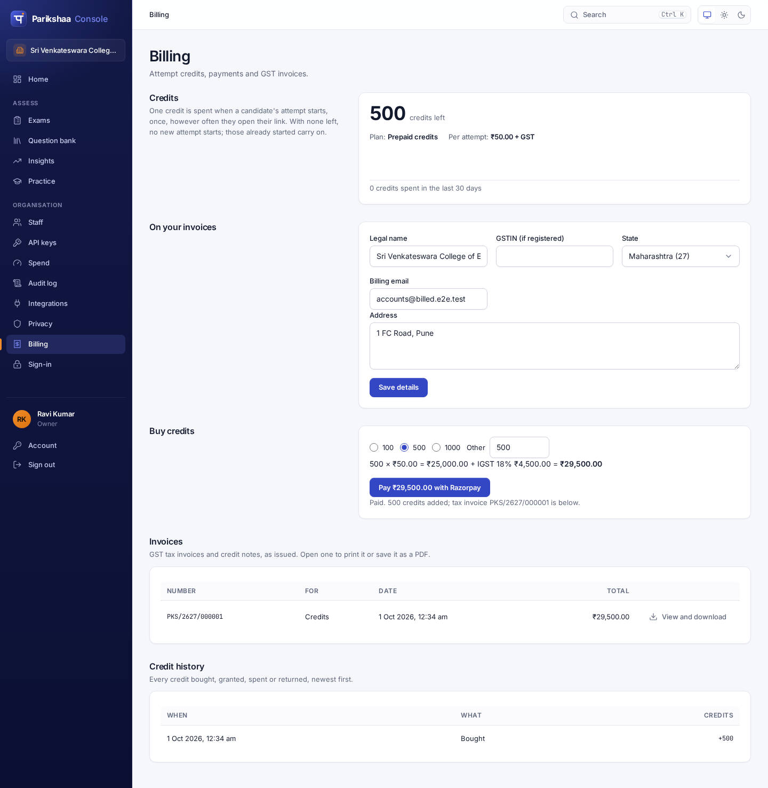

# Operations

Running Parikshaa for real: sizing, logs, limits, backups, and the tests that
say it holds up (ROADMAP §10, §13). Going live on AWS in Mumbai, from one
machine to the managed setup, is in [DEPLOY-AWS.md](DEPLOY-AWS.md).

## Sizing

Measured on one 4-core machine running the load generator, the API and
Postgres 16 together, with a scripted model that takes 2 s per call
(`npm run load -w @parikshaa/e2e`). One machine playing every part makes
these a floor, not a ceiling.

Two runs, each ending with every chain verified intact:

**A realistic drive** — 1,000 candidates opening their links over ten
seconds, a draft saved every ~8 s each, a heartbeat every 30 s, follow-ups,
submissions spread over the last stretch (`1000 3 2000 8 10`):

| Route | Requests | Errors | p50 | p95 | p99 |
|---|---:|---:|---:|---:|---:|
| Save a draft | 17,534 | 0 | 3 ms | 5 ms | 9 ms |
| Heartbeat | 3,920 | 0 | 2 ms | 4 ms | 7 ms |
| Load the attempt | 1,947 | 0 | 2 ms | 5 ms | 8 ms |
| Commit an answer | 1,947 | 0 | 4 ms | 7 ms | 10 ms |
| Open the link | 1,000 | 0 | 7 ms | 14 ms | 22 ms |
| Submit | 1,000 | 0 | 5 ms | 8 ms | 11 ms |
| Follow-up (model: 2 s) | 947 | 0 | 2,004 ms | 2,006 ms | 2,009 ms |

28,850 requests in 189 s, no errors.

**A stress case** — all 1,000 opening their links within *two* seconds, and
saving a draft every ~2 s each (`1000 2 2000 2 2`): 54,409 requests in
122 s, 446 a second on average, **no errors**. Writes stayed fast (drafts p99
18 ms); opening the link slowed to p95 1.0 s, and the first page load to p95
0.55 s, while everyone arrived at once. The cost there is CPU shared by the
generator, the API and Postgres on four cores; a pool larger than 20 made it
slower, not faster.

Grading the 1,000, twenty at a time against a model taking 2 s, took 102 s:
grading throughput is set by the model and the concurrency you give it.

What that means for a sitting:

- **One API instance comfortably serves a 1,000-candidate drive.** Run two,
  behind a load balancer, for the sake of a machine failing — not for
  capacity.
- **Follow-ups and grading are bound by the model, not by this service.** A
  follow-up takes as long as the model does; grading a cohort takes
  (candidates × model latency ÷ concurrency). The real limit is the model
  provider's rate limit for your account — check it before a large drive.
- **Read replicas are not needed at this scale.** Every request is a short
  indexed read or a single-row append; the database was never the
  bottleneck in these runs.

### The database pool

`DATABASE_POOL_MAX` (default 20) is per API instance. Keep
`instances × DATABASE_POOL_MAX` under Postgres's `max_connections`, leaving
room for migrations, backups and a person with psql. For managed Postgres
with a low connection ceiling, put PgBouncer in transaction mode in front:
every query runs inside a transaction that sets its own settings
(`set_config(..., true)`), which transaction pooling supports.

## Measuring what an attempt costs

Once, before pricing, and again after any change to the prompts or the model:
create an organisation that is doing nothing else, give it an API key with
`exam:write`, `attempt:start`, `attempt:grade`, `attempt:assess` and
`usage:read`, and run

    PARIKSHAA_URL=https://<host>/api PARIKSHAA_TOKEN=<key> USD_INR=84 \
      npm run cost-run -- --attempts 50 --seed 1 --out cost-run

It sits the attempts one at a time (each one's cost is the difference in
`/usage` either side of it, which is why the organisation must be otherwise
idle) and writes `cost-run.md` and `cost-run.json`. `--dry-run` prints the
paper and the candidates the seed draws, without calling anything. Fifty attempts are about
four hundred model calls; set the organisation's spend cap first if you want
a hard stop.

## Logs

`LOG_LEVEL` (default `info`; `silent` turns them off). One JSON line per
request on stdout:

```json
{"level":30,"reqId":"…","method":"POST","route":"/attempts/me/answers","status":202,"ms":6,"org":"acme","msg":"request"}
```

The route is the *pattern*, never the URL. Bodies, query strings, headers and
error messages are never logged, because each can carry an answer, a token, a
password or someone's email address. A server fault is logged by its error
type, code and stack only. `observability.test.ts` runs a whole sitting and
fails if any answer, follow-up, reply, credential or contact detail appears in
the log.

Every response carries `x-request-id`, the `reqId` in its log line, so a
support request can be matched to its log without anyone quoting what a
candidate wrote.

A database connection that drops is logged as `database connection lost`
and replaced on the next query; it never stops the process.

## Rate limits

Per API instance, token buckets:

| Who | Rate | Burst |
|---|---|---|
| An organisation (staff sessions and API keys together) | 100/s | 400 |
| One candidate's attempt | 10/s | 60 |

Over the limit is `429` with `Retry-After`. Sign-in, invitation links and
Greenhouse's key are throttled separately, by failed attempts. Behind N
instances an organisation gets up to N times the rate: the limits are for
fairness, not billing.

## Backups and point-in-time recovery

**Use managed Postgres in an Indian region** — Amazon RDS in Mumbai
(ap-south-1) or Hyderabad (ap-south-2), Cloud SQL in Mumbai (asia-south1) or
Delhi (asia-south2), Azure in Central India — with automated backups and
point-in-time recovery on, retained at least 14 days. A drive's results are
settled within a week; two weeks covers the discovery of a problem after that. On AWS,
`deploy/aws` sets this up: 14 days in production, the backups copied to
Hyderabad as well.

**Self-hosting**, archive WAL continuously to object storage with pgBackRest
or WAL-G, and take a base backup nightly. A nightly `pg_dump` alone is not
point-in-time recovery: it loses everything since the dump.

The ledger makes one thing about a restore checkable that usually is not:
whether the data came back *intact*, not merely whether it came back.

**Back up as a role that bypasses row-level security.** The ledger forces
row-level security even on the schema owner, so `pg_dump` as the owner fails
(`query would be affected by row-level security policy`) — a nightly logical
backup set up the obvious way would fail every night. Create a backup role
once, as a superuser:

```sql
CREATE ROLE parikshaa_backup LOGIN PASSWORD '…' BYPASSRLS;
GRANT pg_read_all_data TO parikshaa_backup;
```

Physical backups and managed snapshots are not affected.

### The restore drill

Monthly, and after any change to how backups are taken:

```bash
npm run build
SOURCE_URL=postgres://parikshaa_backup:…@db/parikshaa \
ADMIN_URL=postgres://postgres:…@db/postgres \
DUMP=/backups/latest.dump \
./scripts/restore-drill.sh
```

It restores the dump into a scratch database, verifies every ledger chain in
it (`verify-all`), compares row counts when it took the dump itself from a
quiet source, drops the scratch database, and prints how long the restore
took — your recovery time at today's data size. Point `DUMP` at the file your
real backup job wrote: a drill of a backup nobody takes proves nothing.

For point-in-time recovery, restore to a new instance at a chosen time with
your provider's tools, then run `verify-all` against it:

```bash
DATABASE_URL=postgres://parikshaa_owner:…@restored/parikshaa npm run verify-all -w @parikshaa/api
```

Last run here, after the 1,000-candidate load run: a 1.7 MB dump restored in
under a second, 1,000 chains and 10,196 entries verified in 0.9 s, every
table's row count matching. The first attempt at it is also how the backup-
role requirement above was found.

## The data key and retention (DPDP)

`PARIKSHAA_DATA_KEY` — 32 random bytes, base64 (`openssl rand -base64 32`) —
wraps every attempt's own data key. Candidates' answers, replies and
references are sealed under those keys, so:

- **Keep it out of the database and its backups.** A backup is only
  erasure-proof if the key that opens it is held elsewhere: a secrets manager,
  not an environment file next to the dump.
- **Never lose it.** Without it no sealed ledger can be read again. The chains
  still verify (`verify-all` needs no key), but the answers in them are gone.
- It cannot be rotated in place yet: rotating means re-wrapping every
  `attempt_keys` row, which is a migration to write when it is needed.

Retention runs in every instance, hourly: closed attempts whose last entry is
older than the organisation's retention period are erased. Set
`RETENTION_WORKER=off` on API-only nodes, as with the delivery worker.
Nothing is erased for an organisation that has not set its privacy notice.

## Checking a deployment

`npm run smoke -- https://<your host>` walks a live server through a
college's first day in small, from outside: see step 3 of `PILOT.md`. Run it
after every deploy; it exits non-zero on any failure, so it can gate one.

## Billing

Plans are set by the operator, not the customer:

```bash
export DATABASE_URL=postgres://parikshaa_app:…@db/parikshaa   # the runtime role is enough
npm run billing -w @parikshaa/api -- plan acme prepaid 50        # ₹50 an attempt + GST
npm run billing -w @parikshaa/api -- grant acme 25 "pilot drive"
npm run billing -w @parikshaa/api -- show acme
```

Every organisation at once — owner and whether they confirmed their email,
exams, candidates, grading, credits, the next sitting, messages that failed —
with what needs doing first (see *The college's first days* in `PILOT.md`):

```bash
npm run -s pilot-report -w @parikshaa/api            # add -- --json for JSON
```

**Institutions signing themselves up** (for a pilot) is off unless turned on:

| Variable | |
|---|---|
| `SELF_SIGNUP` | `on` lets anyone make an institution's account from the console's sign-in page. Off otherwise: organisations are made with `admin-cli` only. |
| `SIGNUP_PRICE_RUPEES` | Required with `SELF_SIGNUP=on`: the price per attempt, before GST, once the trial credits are spent. |
| `SIGNUP_TRIAL_CREDITS` | Attempts a new organisation starts with. Default 25. |
| `SIGNUP_NOTIFY_EMAIL` | Optional. Where to email a notice of each new institution: its name, id, owner and trial credits. The pilot report goes here too, each morning after 8 am IST. |
| `PILOT_REPORT` | `off` stops the morning pilot report. It is sent once a day however many instances run. |

Sign-up needs `SMTP_URL` (the server will not start without it), because a
new owner confirms their email address from a link sent to it. Until they
do, they can write and try exams but cannot invite candidates, add staff or
issue API keys; the console says so at the top of every page, with "Send the
link again". Everyone added by the operator (`admin-cli`) or by an owner
counts as confirmed.

Every organisation made this way is prepaid, so a stranger's account can
start no more attempts than its trial credits until its owner buys more; the
console's Home warns at five left and again at none. One network may make
five accounts an hour. The audit log records `org.created` and
`auth.email_verified`.

An organisation with no plan is not metered. A prepaid one starts no attempt
without a credit; its owner buys more on the console's Billing page.

**Selling credits** needs Razorpay and the supplier the invoices name:

| Variable | |
|---|---|
| `RAZORPAY_KEY_ID`, `RAZORPAY_KEY_SECRET` | From the Razorpay dashboard (API keys). Test keys start `rzp_test_`. |
| `RAZORPAY_WEBHOOK_SECRET` | The secret set on the webhook below. |
| `PARIKSHAA_SUPPLIER_NAME`, `_GSTIN`, `_ADDRESS` | The registered legal name, GSTIN and address. The GSTIN is checked at boot. |
| `PARIKSHAA_SUPPLIER_SAC` | Default `998399`; confirm with your accountant. |
| `PARIKSHAA_BANK_ACCOUNT`, `PARIKSHAA_BANK_IFSC` | The current account colleges pay into by NEFT against a quotation; with `PARIKSHAA_BANK_ACCOUNT_NAME` (default: the supplier's name) and `PARIKSHAA_BANK_NAME`. Without them, quotations are not offered. |

**Paying by bank transfer.** An owner gets a quotation on the Billing page (with their purchase order number, if any) and pays by NEFT quoting its `neft_…` reference. When the transfer shows in the bank statement, record it with its UTR:

    npm run billing -w @parikshaa/api -- transfer <org> neft_… <UTR>

That adds the credits and issues the GST tax invoice in one transaction, exactly as a Razorpay payment does. Recording the same quotation twice changes nothing; a UTR already used is refused.

In the Razorpay dashboard, add a webhook to
`https://<your host>/api/billing/razorpay/webhook` for `order.paid`, with the
same secret. It credits a payment whose buyer closed the tab before Checkout
returned; without it, such a payment is credited only when they come back.
Payments must be captured automatically (the dashboard's default for Checkout).

**ATS connectors** (Lever, Zoho Recruit, Darwinbox) are set up by each
organisation's owner under Integrations. **Test connection** there makes one
call to the live account that changes nothing — Lever lists its stages and
checks the mapped ones exist, Zoho exchanges the refresh token in the chosen
data centre, Darwinbox's callback is asked whether it answers — and says what
it found or what was refused. For a pilot against Lever's sandbox, set
`LEVER_API_URL=https://api.sandbox.lever.co` (it applies to every
organisation on the server).


Before taking a real payment, in this order:

1. Put the **test** keys (`rzp_test_…`) and the test-mode webhook in the
   settings file, and run `sudo ./scripts/setup-server.sh` again: it keeps
   `RAZORPAY_*` and `PARIKSHAA_SUPPLIER_*` across re-runs.
2. `SMOKE_BILLING=on SMOKE_EMAIL=… SMOKE_PASSWORD=… npm run smoke -- https://…`
   as the owner of a prepaid organisation with its legal name set: it asks
   Razorpay for an order of one credit, which proves the keys and the supplier
   without paying (the order lapses by itself).
3. On the console's Billing page, buy one pack with a Razorpay test card, and
   check the credits, the tax invoice and the credit history. Close the
   Checkout tab straight after paying once, to see the webhook credit it.
4. Swap in the live keys and the live webhook, re-run setup, and run step 2
   again: it now says "live keys".




**Invoiced organisations** are billed monthly, in arrears, for the attempts
their ledgers show as started in that month (IST). The API issues last month's
invoices by itself early on the 1st (checked every six hours; set
`INVOICE_WORKER=off` on nodes that should not). To issue them by hand:

```bash
npm run billing -w @parikshaa/api -- invoice-all 2026-10
```

Either way each invoice is issued once; running again changes nothing.
Invoices are numbered in one series per financial year, credit notes in
another, and both appear on each owner's Billing page to print.

**Refunds, TDS and e-invoices** are the operator's:

```bash
# Refund 40 unspent credits of a payment, with a credit note (needs the Razorpay keys)
npm run billing -w @parikshaa/api -- refund acme pay_NbC7x… 40 Drive cancelled
# The buyer deducts 2% TDS under 194J: printed on invoices from now
npm run billing -w @parikshaa/api -- tds acme 2
npm run billing -w @parikshaa/api -- tds-certificate acme PKS/2627/000012 118.00 ABCD1234EF "2026-27 Q3"
# E-invoicing: the JSON to upload to the IRP, then what it returned
npm run billing -w @parikshaa/api -- e-invoice acme PKS/2627/000012 > inv.json
npm run billing -w @parikshaa/api -- irn acme PKS/2627/000012 <irn> <ack no> "<ack date>" signed-qr.txt
```

E-invoices need a six-digit PIN code in both the supplier's and the buyer's
address.

## Practice sites as an app, and notifications

A practice site (`/practice/<site>`) installs as an app: the browser reads its
manifest at `/api/practice/<site>/manifest.webmanifest` (named after the site,
opening on the learner's dashboard) and a production build registers
`/sw.js`, scoped to the site. The service worker keeps the page and its
scripts, and the learner's day (who they are, the dashboard, the plan), so the
plan opens without a network. What it keeps is filed under a hash of the
learner's session, so another learner on the same phone never sees it.
Nothing is sent from offline: answers and submissions still need the network.

The daily reminder can also arrive as a notification. That needs a VAPID key
pair, made once and kept (a new pair ends every existing subscription):

```sh
npx web-push generate-vapid-keys
export VAPID_PUBLIC_KEY=... VAPID_PRIVATE_KEY=... VAPID_SUBJECT=mailto:ops@example.in
```

Without them, the reminder is email only and the plan page offers no
notifications. The server sends only to the push services browsers use
(Google's FCM, Mozilla, Apple, Microsoft); a subscription naming any other
address is refused. One the push service says is gone is deleted, and an
erased account's subscriptions go with it.

To be on the Play Store too, the site is wrapped in a Trusted Web Activity:
`TWA_PACKAGE` and `TWA_SHA256` publish `/.well-known/assetlinks.json`, and
`docs/PLAY-STORE.md` has the steps and what the owner provides.

## The hardening suites

`packages/e2e` holds three runs against a real Postgres, each also in CI
(the `e2e` job):

- **Browsers** — `npm run e2e -w @parikshaa/e2e`: a whole sitting with a
  follow-up and a receipt checked by the standalone verifier; answers typed
  offline; a follow-up whose connection drops mid-stream; resuming on
  another device; a recruiter's results, spreadsheet and report. Chrome,
  Firefox and WebKit in CI.
- **Chaos** — `npm run chaos -w @parikshaa/e2e -- 60 3`: the server
  SIGKILLed mid-write, then every database connection terminated under a
  running server. After each, every chain must verify and every candidate
  must be able to reopen their link and carry on.
- **Load** — `npm run load -w @parikshaa/e2e -- 1000 3 2000 8 10`
  (candidates, minutes, model ms, seconds between drafts, seconds over which
  everyone starts).

They need a throwaway Postgres 16 — `trust` authentication on localhost, as
CI uses, or passwords supplied through `PGPASSWORD` or `~/.pgpass` — with
three login roles and a database:

```sql
CREATE ROLE parikshaa_owner LOGIN;
CREATE ROLE parikshaa_app LOGIN;
GRANT pg_signal_backend TO parikshaa_owner;  -- the chaos run terminates connections on purpose
CREATE ROLE parikshaa_backup LOGIN BYPASSRLS;  -- for the restore drill
GRANT pg_read_all_data TO parikshaa_backup;
CREATE DATABASE parikshaa_e2e OWNER parikshaa_owner;
```

and `npm run build && npm run build:clients && npm run build -w @parikshaa/e2e`.
`E2E_OWNER_URL` and `E2E_APP_URL` override the connection strings. Each run
starts from an empty database.

### What they found

The first run against a real Postgres found three faults the in-process test
database could not, and the first restore drill a fourth (the backup role,
above):

1. The previous driver, postgres.js, serialized every `jsonb` parameter a
   second time, so every exam was stored as a JSON *string* and none could be
   loaded. Nothing had worked end to end on a real Postgres.
2. With that driver, terminating the database's connections under a running
   server threw from inside the driver's socket handling and killed the
   process (3.4.9, the latest release). A database failover would have taken
   every API instance down at once.
3. An invitation recorded its attempt id before the attempt existed, so a
   failure between the two locked that candidate out for good.

The driver is now node-postgres, and a redemption now finishes any start an
earlier one left unfinished. Each is covered by a test.
