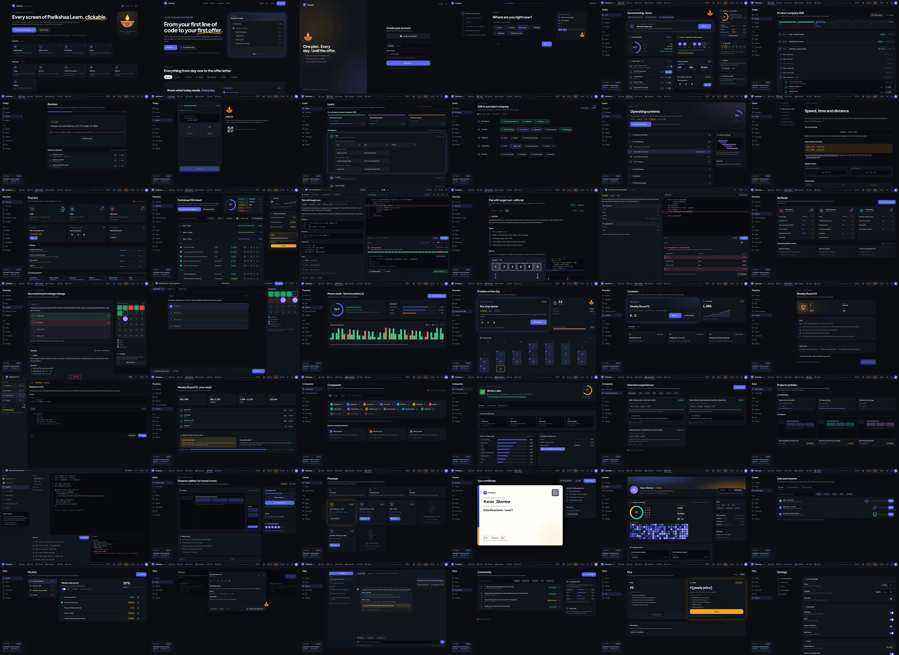

# Learn v2: clickable mock v2 (20 Oct 2026)

Owner ne maanga: "best design mockup banao, saare pages, features, flow, design, icons, animations, sab kuch poora mock
ready karo; pasand aayega to usi ko code karke build karenge". Ye wahi hai: **41 screens + ek naksha (map)**, sab ek
React app me, links aur buttons se jude. Mock v1 ([../mock/README.md](../mock/README.md)) owner ne nakaara tha; v2
[../DESIGN-PLAN-V2.md](../DESIGN-PLAN-V2.md) ke hisaab se bana hai (dark-first, ghana layout, asli jaisa content).

**Dekhne ka link (private, sirf owner):** https://claude.ai/artifact/NsPXqTVifNbLEQB4rsYYmg
Doosron ko dikhana ho to page ke Share menu se.



## Kaise dekhein

- Link kholte hi **naksha (map)** aata hai: har screen ka card, aur 10 flow (pehli baar, roz ka loop, seekho, ...).
  Kisi card par click karo, ya landing se shuru karke button dabate jao.
- Neeche daayein **"All screens"** button se kabhi bhi naksha par wapas.
- **Ctrl+K** (phone par search icon): har screen dhoondo aur kholo.
- Upar **bhasha** (English / Hinglish / हिंदी) aur **theme** (dark / light) badlo; dono yaad rehte hain.
- Phone jaisa dekhna ho to browser chhota karo (390px): neeche tab bar, "More" sheet, phone layout.
- Problem screen par "Mock: see each state" se Input / WA / TLE / AC chaaron haalat dekho.

## Screens (route = link ke peeche `#naam`)

| Flow | Route | Kya dikhata hai, kya click hota hai | Screenshot |
|---|---|---|---|
| Naksha | `#map` | Har screen aur flow ka index | [desktop](screens/desktop/map-1440-dark.jpg) |
| Pehli baar | `#landing` | Hero, ghoomta demo (tasks → verdict → dry run → Sahayak → company → Pramaan), 7 pillar tabs, 3 fark, FAQ, CTA | [desktop](screens/desktop/landing-1440-dark.jpg) · [phone](screens/phone/landing-390-dark.jpg) |
| | `#login` | Google, phone/email, OTP ke dabbe | [desktop](screens/desktop/login-1440-dark.jpg) |
| | `#onboarding` | 6 sawaal, side me plan banta dikhta hai, "plan ban raha hai" checklist, ready card + confetti | [desktop](screens/desktop/onboarding-1440-dark.jpg) · [Hinglish](screens/hindi/onboarding-1440-dark-hg.jpg) |
| Roz ka loop | `#aaj` | Jahan chhoda wahan se, kul pragati, sprint ke din, aaj ke 5 kaam, aaj ka problem countdown, kamzor vishay, streak | [desktop](screens/desktop/aaj-1440-dark.jpg) · [phone](screens/phone/aaj-390-dark.jpg) · [light](screens/light/aaj-1440-light.jpg) · [हिंदी](screens/hindi/aaj-1440-dark-hi.jpg) |
| | `#plan` | Sprints → din → kaam ka tree; din chhoota to 4 raaste aur nayi end date | [desktop](screens/desktop/plan-1440-dark.jpg) |
| | `#revision` | Revision card (SM-2: dobara / mushkil / theek / aasaan), galtiyon ki notebook | [desktop](screens/desktop/revision-1440-dark.jpg) |
| | `#daily` | Daily 10 phone card: output batao, Parsons (line jodo), code keyboard; desktop par QR | [desktop](screens/desktop/daily-1440-dark.jpg) · [phone](screens/phone/daily-390-dark.jpg) |
| Seekho | `#seekho` | Goal aur subject se curriculum | [desktop](screens/desktop/seekho-1440-dark.jpg) |
| | `#roadmap` | Role roadmap; node chuno to drawer (kya padhna, kitna hua) | [desktop](screens/desktop/roadmap-1440-dark.jpg) |
| | `#course` | Syllabus, kahan ruke, project | [desktop](screens/desktop/course-1440-dark.jpg) |
| | `#lesson` | Lesson: formula (MathML), cheat sheet, quiz, FAQ, padhne ki pragati | [desktop](screens/desktop/lesson-1440-dark.jpg) · [phone](screens/phone/lesson-390-dark.jpg) · [light](screens/light/lesson-1440-light.jpg) · [हिंदी](screens/hindi/lesson-1440-dark-hi.jpg) |
| Abhyas | `#abhyas` | Tracks, sheets, aaj ka problem, agla contest | [desktop](screens/desktop/abhyas-1440-dark.jpg) |
| | `#sheet` | DSA sheet: khulne wale steps, filter, status, revision ka nishaan | [desktop](screens/desktop/sheet-1440-dark.jpg) |
| | `#problem` | Workspace: statement + hints ki seedhi, editor, Run/Submit, **sabse chhota galat test**, Sahayak dock, split ka size badlo, task timer | [desktop](screens/desktop/problem-1440-dark.jpg) · [phone](screens/phone/problem-390-dark.jpg) · [light](screens/light/problem-1440-light.jpg) |
| | `#editorial` | Brute / better / best, **dry-run slider** (sketch jaisa chitra), code 4 bhasha me, overflow ki chetavni | [desktop](screens/desktop/editorial-1440-dark.jpg) |
| | `#sql` | Schema, query editor, result table | [desktop](screens/desktop/sql-1440-dark.jpg) |
| | `#potd` | Countdown, coins, streak calendar | [desktop](screens/desktop/potd-1440-dark.jpg) |
| Aptitude | `#aptitude` | Quant / logical / verbal, sets, company-pattern mocks | [desktop](screens/desktop/aptitude-1440-dark.jpg) |
| | `#apt-set` | Practice set, solution, tez tareeka | [desktop](screens/desktop/apt-set-1440-dark.jpg) |
| | `#apt-mock` | NTA jaisa mock: palette, calculator, submit ka saar | [desktop](screens/desktop/apt-mock-1440-dark.jpg) · [phone](screens/phone/apt-mock-390-dark.jpg) |
| | `#apt-result` | Score, har sawaal ka samay, kamzor topic | [desktop](screens/desktop/apt-result-1440-dark.jpg) |
| Contests | `#contests` | Aane wale, pichhle, rating graph | [desktop](screens/desktop/contests-1440-dark.jpg) |
| | `#contest-brief` | Niyam, samay, "Sahayak band rahega" | [desktop](screens/desktop/contest-brief-1440-dark.jpg) |
| | `#contest-live` | Laal timer, problem list, editor | [desktop](screens/desktop/contest-live-1440-dark.jpg) · [phone](screens/phone/contest-live-390-dark.jpg) |
| | `#contest-result` | Rank, rating badlaav, kya seekhna hai | [desktop](screens/desktop/contest-result-1440-dark.jpg) |
| Companies | `#companies` | Product aur service companies, source ke saath | [desktop](screens/desktop/companies-1440-dark.jpg) |
| | `#company` | Rounds, kaunse topic pooche, problems, readiness | [desktop](screens/desktop/company-1440-dark.jpg) · [phone](screens/phone/company-390-dark.jpg) · [light](screens/light/company-1440-light.jpg) |
| | `#experiences` | Round-wise interview experiences | [desktop](screens/desktop/experiences-1440-dark.jpg) |
| Banao | `#build` | Guided labs aur projects | [desktop](screens/desktop/build-1440-dark.jpg) |
| | `#studio` | Code Studio: lab steps, files, tests, terminal | [desktop](screens/desktop/studio-1440-dark.jpg) |
| | `#project` | Project brief: design, requirements, tests, "Ship it" | [desktop](screens/desktop/project-1440-dark.jpg) |
| Career | `#pramaan` | Proctored skill certificates | [desktop](screens/desktop/pramaan-1440-dark.jpg) |
| | `#certificate` | QR se verify, LinkedIn me jodo | [desktop](screens/desktop/certificate-1440-dark.jpg) |
| | `#profile` | Ek portfolio: verified vs khud bataya, heatmap | [desktop](screens/desktop/profile-1440-dark.jpg) · [phone](screens/phone/profile-390-dark.jpg) |
| | `#jobs` | Jobs, applications, resume checker | [desktop](screens/desktop/jobs-1440-dark.jpg) |
| Mera | `#lists` | Public / private problem lists | [desktop](screens/desktop/lists-1440-dark.jpg) |
| | `#notes` | Apni galtiyon se AI notes (draft, edit) | [desktop](screens/desktop/notes-1440-dark.jpg) |
| | `#sahayak` | AI tutor: Seekho aur Banao mode, streamed jawab, "kya theek, kya chhoota", Socratic sawaal | [desktop](screens/desktop/sahayak-1440-dark.jpg) · [phone](screens/phone/sahayak-390-dark.jpg) |
| | `#community` | Charcha aur cohorts | [desktop](screens/desktop/community-1440-dark.jpg) |
| | `#plus` | Free vs Plus; **daam owner tay kare** (`₹[yearly price]`) | [desktop](screens/desktop/plus-1440-dark.jpg) |
| | `#settings` | Bhasha, theme, privacy, notifications | [desktop](screens/desktop/settings-1440-dark.jpg) |

## Design ke faisle (mock me jo dikh raha hai)

| Cheez | Kya | Kahan (code) |
|---|---|---|
| Rang | Dark-first: page `#0b0d12`, panel `#12151c`, text `#e6e8ee`; action indigo `#8b95ff` / `#5b66f2`; saffron `#f5a524` (Plus, coins, haath ki lakeer); ok `#3dd68c`, galat `#f87171`; L1–L5 mushkil ke rang; light theme alag se banaya, ulta nahi | `app/src/tokens.css` |
| Font | Plus Jakarta Sans (UI), Noto Sans Devanagari (हिंदी), JetBrains Mono (code), Kalam (dry-run sketch aur haath ka likha) | `app/src/fonts.css` |
| Icons | lucide (ek hi stroke, 1 jagah se) | har screen |
| Mascot | **Diya** (mitti ka deepak): khush, soch, shabaash, neend, jhaankna; lau timtimati, aankh jhapakti. Sirf concept; asli art illustrator banaye | `app/src/ui/kit.tsx` → `Diya` |
| Logo | `packages/brand` ka प mark | `LogoMark` |
| Layout | Upar sections, baayein section ke pages, beech me kaam, daayein rail; problem/contest/mock/studio full-screen "focus" layout; phone par neeche 5 tab | `app/src/ui/shell.tsx`, `focus.tsx` |
| Animation | Haath ki lakeer khinchti hai, ghoomta demo, Sahayak ka jawab type hota hai, confetti, ring/donut bharte hain, tab ka thumb sarakta hai, skeleton se load, dry-run play, countdown, test ki patti | `kit.tsx`, `demos.tsx`, `dryrun.tsx` |
| Imaandari | Sample data par "sample" likha; nakli company naam; koi nakli testimonial ya result nahi; hints lene par coin nahi katte aur submission par dikhte hain; contest me Sahayak band | har screen |

## Kya sample hai

Sab data nakli hai. Company naam banaye hue hain (Nimbu Labs, Patang Tech, Kesar Cloud, ...), asli company ka data tabhi
aayega jab source ke saath verify ho. Naam (Aarav Sharma), number, rating, streak, coins, sab udaharan. Plus ka daam
khaali chhoda hai. Problem "Pair with target sum" ka galat test (`a = [2³⁰, 2³⁰]`, target `2³¹`, `int` overflow) sach me
galat chalta hai.

## Mock me kya nahi hai

- Admin panel (content factory, package review, AI kharcha) aur Hire ke screens: Learn ke learner screens pehle.
- v1 ke kuch alag page (arenas, HLD canvas, league, alag progress page) v2 me alag screen nahi hain; zaroorat ho to agle round me.
- Hindi: UI ke shabd teeno bhasha me; lesson/problem ka content zyada tar English me.
- Asli backend, login, code chalana: sab dikhawa hai.

## Local par banana

```bash
cd docs/learn/mock-v2/app
npm install
npx vite build && node build-artifact.mjs   # dist/preview.html (poora page), dist/artifact.html (publish wala)
node shots.mjs ../screens/desktop aaj,problem 1440 dark en view   # screenshots (Playwright, /opt/pw-browsers/chromium)
```

`dist/preview.html` browser me seedha khulta hai (fonts andar hi hain). App workspaces ke bahar hai; product code ko nahi chhoota.

## Aage

1. Owner mock dekh kar bataye: kya pasand, kya badalna (screen ka naam + baat kaafi hai).
2. [DESIGN-PLAN-V2.md](../DESIGN-PLAN-V2.md) §10 ke faisle (rang, mascot, naam, ek topic ka asli content, plugins).
3. Haan milne par: tokens aur kit (`app/src/tokens.css`, `app/src/ui`) product ke design system me (D0–D1), phir screens ek-ek karke asli data ke saath.
