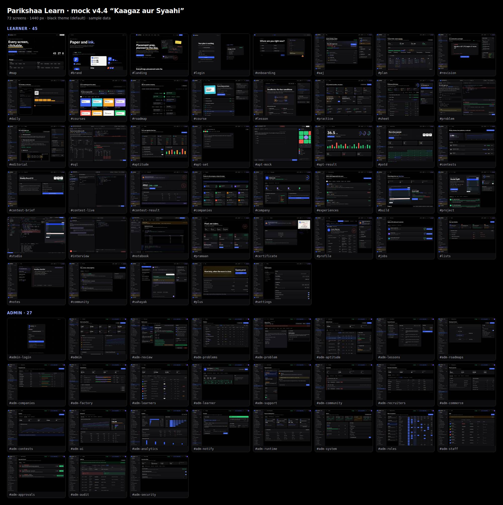

# Learn v2: clickable mock v4.4 (chal raha), "Kaagaz aur Syaahi" (24 Oct 2026, 77 screens)

Mock v3 dekh kar owner ne kaha: "sab achha laga, bas font AI wala lag raha hai; har page complete dark black, sab saaf
dikhe, light me bhi; har border, box, animation refine karo; Code Studio VS Code jaisa; admin ka har page har pehlu se;
human feel." Ye v4 tha: 68 screens (43 learner + naksha/brand, 25 admin); v4.2 me **72**, v4.3 me wahi 72 aur behtar, v4.4 me roop final (neeche), wahi app aur wahi link. Faisla aur
wajah: [../DESIGN-V4.md](../DESIGN-V4.md) (v3 ka dhaancha: [../DESIGN-V3.md](../DESIGN-V3.md)). Purane: v1
[../mock/README.md](../mock/README.md), v2 [../mock-v2/README.md](../mock-v2/README.md).

**Dekhne ka link (private, sirf owner), sabse naya (24 Oct, 77 screens):** https://claude.ai/artifact/PsBMjWL2TwJSDLT5QVmvJG
**Purana link (account 2, 76 screens tak):** https://claude.ai/artifact/LDK6qdh2qKj8WzWYAiN4Zn
**Muse session ka rebuild (23 Oct 2026):** yahi v4.3 bina kisi badlav ke dobara build karke `preview.html` owner ko diya gaya; Muse file link (25 Oct 2026 16:46 UTC tak): https://muse.ai/files/1378887248645809/1135041539468113/ieh6pi5ypdfjrtas0800f1jk/preview.html
Doosron ko dikhana ho to page ke Share menu se.



## v4.4: Interview ka format, AE9 (24 Oct, Kadam 0)

- **AE9 Interview format guide** (`#company` ka naya tab **"Interview ka format"**, `src/screens/format.tsx`): har round ke
  liye **Bina AI / AI ke saath / Pata nahi** badge, kya chalega, kya dekhte, kya laayein, aur **har baat ke neeche uske
  source ke chip** (company ka page, jaancha hua mail, ya verified experiences) + jaanch ki tareekh. Jiska source nahi,
  wo dikhta nahi, sirf ginti: "2 aur baatein nahi dikha rahe" + **Source bhejo**. Upar saar ("4 round: 1 AI ke saath, 3 bina
  AI") aur **SDE 1 / SDE intern** ka switch. Intern me ek round **Pata nahi** (source nahi; "tab tak bina AI maan kar
  chalo") aur ek source 90 din se purana ("purana ho sakta", dashed). Har round ke neeche taiyari ke raaste (bina AI
  interview, ticket lab, code padhna, timed mock). Neeche "Is page ke source" ki list aur bharose ka kram.
- **Companies list:** har card par ek line "AI: 4 me se 1 round AI ke saath / Kisi round me AI nahi / Abhi pata nahi /
  Take-home: AI chalega, batana hoga kaise". Sab company naam banaye hue (sample); asli company ki koi baat nahi.
- Mock switch: `pk43-v-cotab` = `ov` / `q` / `exp` / `fmt` (company page ka tab).
- **Review ke baad theek:** round ki lambai/jagah, AI ka badge aur "naya" badge bhi ab source ke saath (pehle bina source the);
  HR round ka niyam bhi source se; source chip ab button, neeche us source par le jaata; purane source par tike round ki
  ginti saar me; Overview ke rounds ab format tab se milte (Technical 1 bina AI, Technical 2 chhota repo AI ke saath);
  companies list ki line ka icon niyam ke hisaab se, "SDE 1:" aur jaanch ki tareekh; Hindi poori.

## v4.4: Code padhna, AE6 (24 Oct, Kadam 0)

Build ke kram ka Kadam 0 (design freeze, [../CODE-READINESS.md](../CODE-READINESS.md) §4b). Screens ab **77**.

- **AE6 Code padhna** (`#code-read`, naya; Abhyas hub ki "AI ke saath kaam" patti aur drill ki rail se): focus layout, do
  pane: **code** (`library/fines.py`, college library ke fine ke niyam, 219 line asli Python) aur **sawaal**. Teen kadam
  (Padho → Jawab → Nateeja). *Padho:* file ka parichay, kaise padhein, "Is file me" ka naksha (har function par click se code
  me wahi line). *Jawab:* (1) file kya karti hai, 4 me se ek; (2) galti kis line me: code me line par click ya number likho;
  (3) kya badloge aur kaise saabit karoge (likhit). 1 aur 2 bina bheje nahi jaata. *Nateeja:* 3 me se kitna, har sawaal par
  sahi/galat, sawaal 3 ka rubric (wajah, badlav, saboot), sahi badlav ka diff, saboot wala test, ek line yaad rakhne ko,
  copy me save, ab Sahayak se poochho. Sahayak jawab tak band.
- **Galti asli hai:** file chala kar jaancha. Line 73 `if d in HOLIDAYS` me `d` ek `datetime` hai aur `HOLIDAYS` me `date`,
  isliye chhutti ka din bhi late gina jaata (19 → 21 Oct: code 2 din, sahi 1). `d.date()` se test pass.
- **Phone:** do tab (Code / Sawaal), sawaal pehle; code tab me line par tap se line chuni jaati.
- Mock switch: `pk43-v-read` = `read` / `answer` / `result` (screenshot ke liye `VAR="read=result"`). Seedha nateeje par
  khule to "namoona jawab" ka banner aata hai. Sawaal 3 ko mock sirf shabdon se jaanchta (wajah, `.date()`, test); khaali
  chhoda to 0.
- **Review (critic agent, 24 Oct) ke baad theek:** sawaal 3 khaali par bhi aadha number milta tha; Python me do aur jagah
  (ghadi ke samay se tulna, exam-week ka niyam) jinhe sahi padhne wala bhi galti keh sakta tha, ab saaf (line 73 hi akeli
  galti, chala kar dobara saabit); bina jawab Nateeja; kadam badalne par focus aur scroll; galat line number par saaf
  sandesh; phone par 40 px line; band code pane naksha dabane par khulta; galti ki line par likha nishaan; Hindi poori.
- Saath me theek: tablet chaudai (≤1180 px) par sidebar sirf icon dikhata tha aur un links ka naam screen reader ko nahi
  milta tha (har shell screen par axe `link-name`); ab har link aur Sahayak/user button ka naam hai.

## v4.4: AI ke saath kaam, doosra hissa (24 Oct, kadam 44-4)

Owner (24 Oct): **"AE1 AE4 AE7 AE8 bhi mock me banao."** Screens ab **76**.

- **AE1 "AI ke saath kaam" track** (`#ai-track`, naya; Seekho me sidebar par): 10 padaav ka raasta (AI kahan achha,
  context dena, code se pehle plan, AI ka diff padhna, galat output, test se saabit, kab AI na lein, data/privacy ki
  seema, teen ticket labs, Pramaan AI-Saath). Abhi wala padaav khula: **kamzor vs achha prompt** aur **dheeli vs jaanchne
  layak shart** ka udaharan, lesson/practice/lab ke button. Rail me Pramaan AI-Saath ki pragati, "ye track kyun", AI
  kahan khula/band.
- **AE4 AI istemal report** (`#ai-report`, naya; Sahayak page, ticket lab ke nateeje aur track se): teen hisse (kitna
  context diya, AI ka output jaancha, aage-peeche baat), har ek ke saath shabd me level (number nahi), 6 hafte ki line,
  aur **saboot**: asli prompt/jawab, kahan se aur kab, achha ya kamzor, us pal par jaane ka teer. "Jab AI nahi liya",
  "agle hafte ek aadat", "kaise banti" (galat ho sakti), aur rail me data: sirf aap, download, delete.
- **AE7 Readiness ke do hisse:** Aaj ki rail aur company page par **Buniyaad (bina AI) 66 · AI ke saath kaam 46**, wazan
  60/40 se kul 58 (pehle wala number wahi).
- **AE8 Kaagaz ki line:** profile ke saboot ke kaagaz me **"AI ke saath kaam (ticket labs)"**: 1/3, Canteen Queue 3/3
  tickets + viva 2½/3, "lab tests + apne code par viva · Pramaan AI-Saath baaki". Ticket lab ke nateeje par bhi yahi baat.

## v4.4: AI ke saath kaam (24 Oct, kadam 44-4)

Owner (24 Oct): **"haa sab sujhaav theek hai, AE2 AE3 AE5 mock me banao."** Kyun aur research:
[../../research/AI-ERA-PLAN-2026.md](../../research/AI-ERA-PLAN-2026.md); poori list AE1–AE9: [../../LEARN-V2.md](../../LEARN-V2.md) §4c.
Screens ab **74** (2 naye). Teeno sirf seekhne ke liye: kahin hiring score nahi.

- **AE2 Ticket lab** (`#ticket-lab`, naya; Banao → lab): chhota asli repo "Canteen Queue" (React + Node + MongoDB, sample)
  me 3 bug tickets (bill ka paisa, rush me do baar order, UTC time). 5 kadam, upar stepper se: **Samjho** (tickets +
  repo + niyam) → **Plan** (`PLAN.md`: kya galat, scope andar/bahar, tareeka, acceptance shartein, risk; niyamon wali
  jaanch ek dheeli shart pakadti; har ticket ki jaanchne layak shart ke bina agent band) → **Banao** (3 pane: code,
  Agent, tests; agent ke har badlav par diff card, maanne ya mana karne par ek line "kyun" zaroori; ek sujhaav wajah ke
  saath mana kiya hua; tests ticket-war) → **Viva** (apne code par 3 sawaal, agent band; ek jawab "adhoora": race
  condition ka test nahi) → **Nateeja** (3/3 ticket, plan ki shartein, viva, samay; agent ke saath kaise kaam kiya;
  Pramaan AI-Saath ki pragati 1/3).
- **AE3 Galat AI pakdo** (`#ai-drill`, naya; Abhyas me sidebar par): roz 3 drill, 5 minute. AI ka likha code (binary
  search, `while lo < hi`) → galat line chuno → sabse chhota failing test (`[5]`, 5 → AI −1, sahi 0) → line theek karo →
  galti ki kism + ek line yaad. Side me is hafte ki kismein (off-by-one, edge case, security, banaya hua API) aur streak.
- **AE5 Mock interview ke do roop** (`#interview`): upar daayein **Bina AI / AI ke saath**. Setup me do bade card (kis
  company type ke liye); AI wale live me interviewer aapke faislon par "kyun" poochhta hai, code ke neeche AI saathi
  (har prompt report me); report ke 5 hisse har ek ke saath transcript ka time (saboot), aur "bina-AI round bhi do".
- **Raaste:** Abhyas hub me "AI ke saath kaam" ki patti (drill, ticket lab, interview), Banao page par ticket lab ka card,
  Aaj ki "Aage" list me aaj ka drill.
- **Saath me theek:** chune hue AI tab/toggle (Sahayak, Agent) par text ab `--on-ai` (kaale me contrast theek); code me
  hari (`good`) line ka rang aadha, taaki light me bhi 4.5:1.

## v4.4: roop final (24 Oct)

Owner (24 Oct): **"Aaj ka A aur profile ka B final karo."** v4.4 ka kadam 44-1 ([../../LEARN-HANDOFF.md](../../LEARN-HANDOFF.md) §5):

- **Aaj = A "Ek kaam"** (`#aaj`): agla kaam sabse upar aur bada (Jaari rakho, Fail kyun? Poochho), baaki "Phir" ki chhoti
  list, side me "Is hafte" aur "Aage". Kaagaz (B), Timeline (C) aur v4.2 wala Aaj hata diye.
- **Profile = B "Saboot ka kaagaz"** (`#profile`): profile ab ek document hai jo HR kholta hai. Upar HR ko share karo,
  Resume PDF, HR ki nazar se, Edit; tabs **Saboot ka kaagaz · Coding sites · Projects · Profile card** (v4.2 ke kaam
  wahi rahe). Kaagaz me ab internship ki line aur pichhle 26 hafte ka practice heatmap bhi. Saar pehle (A), Kahani (C)
  aur v4.2 wala dashboard hata diye.
- Upar wala "Mock · roop chuno" switch gaya. Neeche-baayein "Haalat" switch abhi hai (5 haalatein dekhne ke liye; 44-5 me
  jaayega).
- Agla: 30 minute ka user test ab **chune roop par** (script, kadam 44-0), phir test ki dikkato ke fix (44-2).

## v4.3 me naya (23 Oct)

Owner (23 Oct): "v4.3 shuru karo" (best design ki taraf: jaanch + 5 sudhaar). Screens wahi 72; badlav:

- **Aaj ke 3 roop** (`#aaj`, upar "Mock · roop chuno" se badlo): **A Ek kaam** (agla kaam sabse upar aur bada, baaki chhoti
  list, side me sirf 2 card; phone ki pehli screen par kaam + 3 aur), **B Kaagaz** (din ek ruled panne par: margin me samay,
  haath ke notes, abhi wala kaam marker se), **C Timeline** (shaam ek samay ki patti par, "abhi" ki laal line, poori
  chaudai). **v4.2** bhi tulna ke liye. *24 Oct: A chuna gaya, baaki hate (upar v4.4).*
- **Profile ke 3 roop** (`#profile`): **A Saar pehle** (6 dabbon ki jagah 3 number), **B Saboot ka kaagaz** (letterhead,
  Pramaan mohar, table: kya, level, saboot, kaise jaancha, kab; phone par har line ek card), **C Kahani** (naya pehle,
  har ek ke saath saboot). v4.2 bhi. *24 Oct: B chuna gaya, baaki hate.*
- **Dark me gehraai:** kaala page, card thoda utha hua (`--panel` + halki roshni), menu aur modal aur upar; card ki dhaar
  naram. Halka text ab har jagah padhne layak (4.5:1).
- **Focus bar halki:** problem, SQL, Studio, notebook me bhasha, theme, shortcuts, pichhla/agla ek **⋯ menu** me.
- **6 khaas pal** (Diya + haath ki line + kabhi mohar): pehla AC (problem → AC), Pramaan pass (`#certificate`), contest
  ka naya best (`#contest-result`), HR ne profile kholi (`#profile` side), aur Aaj par din poora / plan halka / streak bachi
  ("Halka karo" se). Sab ek saath `#brand` → 07b.
- **12 mukhya screens ki 5 haalatein:** neeche-baayein **"Haalat"** se pehli baar, khaali, loading, error, offline (Aaj, plan,
  problem, SQL, DSA sheet, revision, lesson, aptitude set, contests, profile, Studio, notebook).
- **Accessibility saaf:** axe (WCAG 2.2) me 72 screens, dono theme, computer + phone, English + Hindi: **0**. Pehle 69–72
  screens par dikkat thi. Phone par har button kam se kam 40 px (pehle 889 chhote touch, ab 0).
- Kharch aur samay ka naya naap: [../ALL-IN-ONE.md](../ALL-IN-ONE.md) §8a.

Screenshots: `screens/v43/` (Aaj aur problem ki 5 haalatein, 6 pal). Roop A/B/C ke purane screenshots 24 Oct ko hataye;
chune roop ke screenshots `screens/desktop`, `light`, `phone`, `hindi` me.

## v4.2 me naya (21 Oct)

Owner (21 Oct): "A wala logo final; user aur admin dono taraf features; landing aur behtar; AI/ML ke liye Colab jaisa;
SQL page DSA jaisa; profile me sab, HR se share, baaki platforms ka saar, profile card; aur kya naya; code ke liye kya
chahiye; sab GitHub par taaki doosre account se wahi design bane." Ab **72 screens** (45 learner + naksha/brand, 27 admin).

- **Logo A final** ("Pass": P ka danda hi sunehre tick ki lambi line). B/C hataaye. Favicon bhi yahi. `#brand` par
  banawat ka grid, khaali jagah, app icon, don'ts.
- **SQL = DSA jaisa** (`#sql`): wahi workspace (Problem / Editorial / Submissions, default 2 pane, Sahayak teesra), schema
  cards, example ki tables, hints, `query.sql` editor + dialect, Tests / WA / Error / AC 6 datasets par. Sahayak SQL ki
  baat karta hai (LIMIT vs window function).
- **Profile HR ke liye** (`#profile`): mazbooti meter, 6 KPI, skills saboot ke saath, padhai/internship, 6 coding sites ka
  saar (har number ke saath "kaise jaancha"), **"HR ko share karo"** (ek company ka link expiry ke saath ya public; HR kya
  dekhe toggles; WhatsApp/LinkedIn/Email/QR/PDF), **"HR ki nazar se"** view, **profile card** 3 size me, "kisne dekha".
- **ML notebook** (`#notebook`): Jupyter jaise cells, DataFrame, chart, leakage ki chetavani, CPU job; runtime: browser
  Python / Parikshaa CPU / **Colab me GPU** (Drive se jaata-aata hai; grade yahin, chhupa test bahar nahi). Banao me
  "Mandi Price Forecast" project.
- **AI mock interview** (`#interview`): setup → live (awaaz + code, Sahayak band) → report (5 rubric; "hiring score nahi").
- **Landing gehra** (`#landing`): 8 tracks, "kuch install nahi" (Studio / Notebook / SQL), 12 hafte ka raasta, HR ke liye
  (asli profile card), videos vs Parikshaa tulna, Sahayak ke niyam, 4 naye FAQ.
- **Admin:** `#adm-runtime` (browser / CPU / Colab / GPU labs ka kharch aur seema, linked sites ki haalat + band karo,
  keys sirf "set hai ya nahi") aur `#adm-recruiters` (share links, recruiter domain jaanch, fee maangne jaisi
  shikayatein, suspend = 4-eyes). Roles matrix me dono module.
- **Docs (code ke liye):** [../DESIGN-SYSTEM.md](../DESIGN-SYSTEM.md) (design ka ek sach),
  [../CODE-READINESS.md](../CODE-READINESS.md) (aapse kya chahiye, connectors, phases),
  [../FEATURE-IDEAS.md](../FEATURE-IDEAS.md) (aur kya jod sakte hain).

## v4.1 me naya (owner ki raay ke baad, 20 Oct)

Owner: font aur kaala ✅, roles + 4-eyes ✅, daam testing ke baad, asli code abhi ruko. Saath me maanga: problem page
default 2 pane, Sahayak par 3 aur band karne par wapas 2 (apne aap adjust); P se naya logo; Studio aur behtar; har page
par animation, smoothness, naye features. Kya bana:

- **Problem aur SQL: default 2 pane** (Statement | Code). Sahayak button, Ctrl+J ya "Ask Sahayak" se teesra pane
  dheere se khulta hai aur baaki do khud chhote hote hain; × ya Ctrl+J se band karo to wapas 2 me phail jaate hain.
- **P se logo, teen option** (`#brand` → "Logo: P banane ke teen raaste"): A *Pass* (P ka danda hi tick), B *Prompt*
  (P ka pet code ka `>`, neeche cursor), C *Pragati* (P ka aadha pet peela). Har option 96/48/28/16 px par kaale aur
  kaagaz par, browser tab me kaisa dikhega, aur khoobi / khatra. **"Poore app me lagao"** dabao to wahi logo sidebar,
  Studio, certificate, landing, har jagah. Abhi A laga hai.
- **Studio aur behtar:** gutter me badli lines ke nishaan (hara = naya, neela = badla), laal squiggle par hover card,
  Ctrl+. ya bulb se **quick fix** jo pehle badlav dikhata hai (aur milestone par "madad li" likhta hai), Ctrl+I se
  **line ke neeche Sahayak** jo sirf hint deta hai, Source control me file dabao to **diff**, tests **ek-ek karke**
  chalte dikhte hain; fix + "Kaam jaancho" se 8/12 → 10/12, preview me ₹0 wala transfer gayab.
- **Motion:** modal, drawer, menu, toast aate bhi aur jaate bhi smooth; tab ki line khisak kar agle tab par; meter
  bharte hue aate; Sahayak pane apna column badha kar khulta (page bagal me dheere sikudta).
- **Naye features:** bell se **notifications** (Sab / Aapke liye, sab padh liya, shaant samay); kahin bhi **`?`**
  dabao to shortcut list; **G phir akshar** se jump (G A Aaj, G P Abhyas, G S Seekho...).
- "Reduce motion" chalu ho to sab animation band.

## Kaise dekhein

- Link kholte hi **naksha** (`#map`). Kisi card par click karo, ya `#landing` se shuru karo. Neeche **"All screens"**
  se kabhi bhi wapas.
- Ab **kaala theme default** hai. Upar ka chand/suraj button light "kaagaz" par le jaata hai; chuna hua yaad rehta hai.
  Bhasha: English / Hinglish / हिंदी.
- **Ctrl+K** koi bhi screen. **Ctrl+J** Sahayak. **Ctrl+\\** sidebar chhota. **?** saare shortcuts.
- **Problem, SQL:** pehle Statement | Code do pane; Sahayak kholo to teesra pane, band karo to wapas do. Beech ki patti
  khinch kar size.
- **Code Studio (`#studio`):** VS Code jaisa. Activity bar se Explorer / Search / Source control / Testing / Steps,
  Ctrl+B side bar, Ctrl+` panel, Ctrl+J Sahayak, Ctrl+Shift+P command palette, beech ki patti khinch kar size,
  tabs par × se band, "Check my work" se tests, Ctrl+. quick fix, Ctrl+I line par Sahayak, Source control se diff.
- **Admin:** `#admin-login` ya `#admin`. Upar **"Viewing as"** se role badlo (Finance, Editor, Analyst...): band module
  par taala, band button par "Chahiye: ...", page role me nahi to "Request access". Risky kaam par wajah + doosre
  insaan ki manzoori.

## v3 se kya badla

| v3 | v4 |
|---|---|
| Instrument Serif + Geist: AI-bane pages jaisa jod | **IBM Plex Sans** + **Plex Sans Devanagari** (Hindi aur English ek jaise), code ke liye **JetBrains Mono**; bade title bold sans, italic nahi |
| Light default, dark hara-kaala (blackboard) | **Kaala default** (`#000`), har dhaar aur icon dikhe; light "kaagaz" bhi utna hi saaf |
| Alag-alag radius aur halki dhaar | Ek radius set (6/8/12/14), dikhne wali dhaar, button/input/checkbox/table ki saaf haalat, popup kaale par alag |
| Studio: 4 pane wala editor | **VS Code jaisa workbench** (upar dekho) |
| Kuch admin pages patle | Learners, community, aptitude, companies, contests, problem editor gehre: saved views, tabs, bulk, loading haalat, editors |

## Screens (route = link ke peeche `#naam`)

| Hissa | Route | Kya dikhata hai | Screenshot |
|---|---|---|---|
| Naksha | `#map` | Har screen ka card aur flow; yahin se kuch bhi kholo | [desktop](screens/desktop/map-1440-dark.jpg) |
|  | `#brand` | **Final logo A** (banawat, khaali jagah, app icon, don'ts), rang (kaala aur kaagaz), IBM Plex font, components, motion | [desktop](screens/desktop/brand-1440-dark.jpg) |
| Pehli baar | `#landing` | Home: hero me kaagaz par aaj ka plan, din kaise chalta hai, kya alag hai (sabse chhota fail test, scrub hone wala editorial, Sahayak pehle poochhta), aptitude, company prep source ke saath, Banao | [desktop](screens/desktop/landing-1440-dark.jpg) · [light](screens/light/landing-1440-light.jpg) · [phone](screens/phone/landing-390-dark.jpg) · [हिंदी](screens/hindi/landing-1440-dark-hi.jpg) |
|  | `#login` | Google, phone OTP, email; graph-paper par | [desktop](screens/desktop/login-1440-dark.jpg) |
|  | `#onboarding` | 6 sawaal, side me plan banta dikhta hai | [desktop](screens/desktop/onboarding-1440-dark.jpg) |
| Roz ka loop | `#aaj` | Aaj ke kaam, jahan chhoda wahan se, streak, kamzor vishay | [desktop](screens/desktop/aaj-1440-dark.jpg) · [light](screens/light/aaj-1440-light.jpg) · [phone](screens/phone/aaj-390-dark.jpg) · [हिंदी](screens/hindi/aaj-1440-dark-hi.jpg) |
|  | `#plan` | Sprints → din → kaam; din chhoota to raaste | [desktop](screens/desktop/plan-1440-dark.jpg) |
|  | `#revision` | Revision cards aur galtiyon ki copy (laal pen) | [desktop](screens/desktop/revision-1440-dark.jpg) |
|  | `#daily` | Daily 10: phone par 10 chhote sawaal | [desktop](screens/desktop/daily-1440-dark.jpg) |
| Seekho | `#courses` | Notebook covers jaise courses, goal se filter | [desktop](screens/desktop/courses-1440-dark.jpg) · [light](screens/light/courses-1440-light.jpg) |
|  | `#roadmap` | Role roadmap; node dabao to drawer | [desktop](screens/desktop/roadmap-1440-dark.jpg) |
|  | `#course` | Syllabus, pragati, project | [desktop](screens/desktop/course-1440-dark.jpg) |
|  | `#lesson` | Copy jaisi margin me teacher ke note, chalne wala code, quiz | [desktop](screens/desktop/lesson-1440-dark.jpg) · [light](screens/light/lesson-1440-light.jpg) · [phone](screens/phone/lesson-390-dark.jpg) · [हिंदी](screens/hindi/lesson-1440-dark-hi.jpg) |
| Abhyas | `#practice` | Tracks, sheets, aaj ka problem, agla contest | [desktop](screens/desktop/practice-1440-dark.jpg) · [phone](screens/phone/practice-390-dark.jpg) |
|  | `#sheet` | Kadam-dar-kadam DSA sheet | [desktop](screens/desktop/sheet-1440-dark.jpg) |
|  | `#problem` | Pehle **Statement | Code**; Sahayak khole to teesra pane khud adjust hokar, band karo to wapas do; "Mock: see each state" se WA/TLE/AC | [desktop](screens/desktop/problem-1440-dark.jpg) · [light](screens/light/problem-1440-light.jpg) · [phone](screens/phone/problem-390-dark.jpg) · [हिंदी](screens/hindi/problem-1440-dark-hi.jpg) |
|  | `#editorial` | Brute → better → best, dry run slider | [desktop](screens/desktop/editorial-1440-dark.jpg) · [light](screens/light/editorial-1440-light.jpg) |
|  | `#sql` | **DSA jaisa workspace:** Problem / Editorial / Submissions, schema, example tables, query editor, Tests / WA / Error / AC | [desktop](screens/desktop/sql-1440-dark.jpg) · [light](screens/light/sql-1440-light.jpg) · [phone](screens/phone/sql-390-dark.jpg) |
|  | `#aptitude` | Quant, logical, verbal, mocks | [desktop](screens/desktop/aptitude-1440-dark.jpg) |
|  | `#apt-set` | Tareeka aur shortcut ke saath practice set | [desktop](screens/desktop/apt-set-1440-dark.jpg) |
|  | `#apt-mock` | Asli jaisa timed mock (Sahayak band, taala) | [desktop](screens/desktop/apt-mock-1440-dark.jpg) · [phone](screens/phone/apt-mock-390-dark.jpg) |
|  | `#apt-result` | Score, har sawaal ka samay | [desktop](screens/desktop/apt-result-1440-dark.jpg) |
|  | `#potd` | Roz ek problem, streak | [desktop](screens/desktop/potd-1440-dark.jpg) |
|  | `#ai-drill` | **Galat AI pakdo (AE3):** roz 5 minute; galat line, failing test, fix, seekh | [desktop](screens/desktop/ai-drill-1440-dark.jpg) · [light](screens/light/ai-drill-1440-light.jpg) · [phone](screens/phone/ai-drill-390-dark.jpg) |
|  | `#code-read` | **Code padhna (AE6):** anjaan 219 line ka Python; kya karta, galti kahan, kya badloge; Sahayak jawab tak band | [har kadam](screens/v44/) · [phone](screens/v44/code-read-answer-390-dark.jpg) |
|  | `#ai-track` | **AI ke saath kaam track (AE1):** 10 padaav, kamzor vs achha prompt, Pramaan AI-Saath | [desktop](screens/desktop/ai-track-1440-dark.jpg) · [light](screens/light/ai-track-1440-light.jpg) · [phone](screens/phone/ai-track-390-dark.jpg) |
|  | `#contests` | Aane wale, pichhle, rating | [desktop](screens/desktop/contests-1440-dark.jpg) · [phone](screens/phone/contests-390-dark.jpg) |
|  | `#contest-brief` | Niyam, shuru | [desktop](screens/desktop/contest-brief-1440-dark.jpg) |
|  | `#contest-live` | Timer, problems, editor (Sahayak band) | [desktop](screens/desktop/contest-live-1440-dark.jpg) |
|  | `#contest-result` | Rank, rating, kya seekhna | [desktop](screens/desktop/contest-result-1440-dark.jpg) |
| Career aur Banao | `#companies` | Company ke hisaab se taiyari (naam nakli); har card par AI ka niyam | [desktop](screens/desktop/companies-1440-dark.jpg) |
|  | `#company` | Rounds, topics, readiness; **Interview ka format (AE9):** har round me AI haan / nahi / pata nahi, har baat ka source + tareekh | [desktop](screens/desktop/company-1440-dark.jpg) · [light](screens/light/company-1440-light.jpg) · [phone](screens/phone/company-390-dark.jpg) · [format](screens/v44/company-format-1440-dark.jpg) · [format phone](screens/v44/company-format-390-dark.jpg) |
|  | `#experiences` | Round-dar-round interview experiences | [desktop](screens/desktop/experiences-1440-dark.jpg) |
|  | `#build` | **Naya Banao hub:** jaari project ka asli preview, tracks, project gallery, labs | [desktop](screens/desktop/build-1440-dark.jpg) · [phone](screens/phone/build-390-dark.jpg) |
|  | `#project` | **Naya project page:** spec, milestones (acceptance + tests), rubric, Studio me kholo | [desktop](screens/desktop/project-1440-dark.jpg) |
|  | `#studio` | **VS Code jaisa Code Studio:** title bar + command center (Ctrl+Shift+P), activity bar, explorer (git M/U, error ginti), tabs + breadcrumbs, code lens, galat line ke neeche error, minimap, live preview doosre group me, panel (Problems, Output, Terminal, Test results, Ports), status bar, Sahayak daayein (Ctrl+J), Ctrl+B / Ctrl+` | [desktop](screens/desktop/studio-1440-dark.jpg) · [light](screens/light/studio-1440-light.jpg) · [phone](screens/phone/studio-390-dark.jpg) |
|  | `#notebook` | **ML notebook:** cells, DataFrame, chart, leakage check, CPU job; runtime browser / CPU / Colab GPU | [desktop](screens/desktop/notebook-1440-dark.jpg) · [light](screens/light/notebook-1440-light.jpg) · [phone](screens/phone/notebook-390-dark.jpg) |
|  | `#pramaan` | Proctored certificate test | [desktop](screens/desktop/pramaan-1440-dark.jpg) |
|  | `#certificate` | Mohar wala certificate, QR se verify | [desktop](screens/desktop/certificate-1440-dark.jpg) |
|  | `#profile` | **HR ke liye profile:** skills saboot ke saath, coding sites ka saar, share link (expiry, view log), "HR ki nazar se", profile card | [desktop](screens/desktop/profile-1440-dark.jpg) · [light](screens/light/profile-1440-light.jpg) · [phone](screens/phone/profile-390-dark.jpg) · [हिंदी](screens/hindi/profile-1440-dark-hi.jpg) |
|  | `#interview` | **AI mock interview, do roop:** bina AI / AI ke saath; setup, live (awaaz + code, AI saathi), report (rubric + transcript ke saboot) | [desktop](screens/desktop/interview-1440-dark.jpg) · [light](screens/light/interview-1440-light.jpg) · [phone](screens/phone/interview-390-dark.jpg) |
|  | `#ticket-lab` | **Ticket lab (AE2):** asli repo, 3 bug tickets; Samjho → PLAN.md → Agent + diff + tests → viva → nateeja | [desktop](screens/desktop/ticket-lab-1440-dark.jpg) · [light](screens/light/ticket-lab-1440-light.jpg) · [phone](screens/phone/ticket-lab-390-dark.jpg) · [har kadam](screens/v44/) |
|  | `#ai-report` | **AI istemal report (AE4):** context, jaanch, aage-peeche baat; har line ke saath saboot; sirf aap | [desktop](screens/desktop/ai-report-1440-dark.jpg) · [phone](screens/phone/ai-report-390-dark.jpg) |
|  | `#jobs` | Jobs, applications, resume par laal-pen check | [desktop](screens/desktop/jobs-1440-dark.jpg) |
| Mera | `#lists` | Problem lists | [desktop](screens/desktop/lists-1440-dark.jpg) |
|  | `#notes` | Apni galtiyon se notes | [desktop](screens/desktop/notes-1440-dark.jpg) |
|  | `#community` | Charcha aur groups | [desktop](screens/desktop/community-1440-dark.jpg) |
|  | `#sahayak` | Sahayak poora page | [desktop](screens/desktop/sahayak-1440-dark.jpg) |
|  | `#plus` | Free vs Plus (daam owner tay karega) | [desktop](screens/desktop/plus-1440-dark.jpg) |
|  | `#settings` | Bhasha, theme, privacy | [desktop](screens/desktop/settings-1440-dark.jpg) |
| Admin | `#admin-login` | Staff sign-in: SSO ya email, phir 6 ank ka 2FA; naya device, IP list | [desktop](screens/desktop/admin-login-1440-dark.jpg) |
|  | `#admin` | Dashboard: KPI (role ke hisaab se chhupe), "aapka dhyan chahiye", pipeline, kamaai | [desktop](screens/desktop/admin-1440-dark.jpg) · [light](screens/light/admin-1440-light.jpg) · [phone](screens/phone/admin-390-dark.jpg) |
|  | `#adm-review` | Review queue: learner jaisa preview, machine checks, checklist poora hone tak approve band | [desktop](screens/desktop/adm-review-1440-dark.jpg) |
|  | `#adm-approvals` | 4-eyes: risky kaam doosre insaan ki manzoori tak ruke; apni request khud approve nahi | [desktop](screens/desktop/adm-approvals-1440-dark.jpg) |
|  | `#adm-problems` | Saare problems: filter, bulk, delete par 4-eyes | [desktop](screens/desktop/adm-problems-1440-dark.jpg) |
|  | `#adm-problem` | Problem editor, 8 tab: statement (EN/HG/हि), tests, solutions, editorial editor (outline + preview), visuals (dry-run frames JSON + frames), meta, checks, history | [desktop](screens/desktop/adm-problem-1440-dark.jpg) · [light](screens/light/adm-problem-1440-light.jpg) |
|  | `#adm-aptitude` | Items (selection + bulk), practice sets, mock pattern builder (sections, minute, negative marking, live total), answer-key reports | [desktop](screens/desktop/adm-aptitude-1440-dark.jpg) |
|  | `#adm-lessons` | Course tree + block editor (text, code, visual, callout, quiz) | [desktop](screens/desktop/adm-lessons-1440-dark.jpg) |
|  | `#adm-roadmaps` | Roadmap graph editor | [desktop](screens/desktop/adm-roadmaps-1440-dark.jpg) |
|  | `#adm-companies` | Companies, verify karne wale facts (saboot ke saath), source ke niyam; bina source fact chhupa | [desktop](screens/desktop/adm-companies-1440-dark.jpg) |
|  | `#adm-factory` | AI content factory: batches, stages, kharch, pause/stop | [desktop](screens/desktop/adm-factory-1440-dark.jpg) |
|  | `#adm-learners` | Saved views (Plus, Campus, risk me, reported), summary, loading haalat, 10 learners | [desktop](screens/desktop/adm-learners-1440-dark.jpg) · [light](screens/light/adm-learners-1440-light.jpg) |
|  | `#adm-learner` | Ek learner: email/phone masked (reveal log hota), plan, activity, "learner ki nazar se" 4-eyes | [desktop](screens/desktop/adm-learner-1440-dark.jpg) · [phone](screens/phone/adm-learner-390-dark.jpg) |
|  | `#adm-support` | Ticket aur "galti batao" ek inbox, andar ka note | [desktop](screens/desktop/adm-support-1440-dark.jpg) |
|  | `#adm-community` | Flags (rakho, spoiler, mute, ban 4-eyes), experiences, saare posts, mute/ban + appeal | [desktop](screens/desktop/adm-community-1440-dark.jpg) |
|  | `#adm-recruiters` | Share links aur views, recruiter companies + domain jaanch, shikayatein (fee maangna), suspend 4-eyes | [desktop](screens/desktop/adm-recruiters-1440-dark.jpg) |
|  | `#adm-commerce` | Plans, limits, coupons, orders, ₹5,000+ refund par 4-eyes, GST invoice | [desktop](screens/desktop/adm-commerce-1440-dark.jpg) |
|  | `#adm-contests` | Saare contests ki list, live monitor, setup, copy check, rating publish | [desktop](screens/desktop/adm-contests-1440-dark.jpg) |
|  | `#adm-ai` | Sahayak AI: kharch, cap, limits, prompts (A/B), evals, har mode ka kill switch | [desktop](screens/desktop/adm-ai-1440-dark.jpg) |
|  | `#adm-analytics` | Funnel, weekly retention, kis content par kaam chahiye | [desktop](screens/desktop/adm-analytics-1440-dark.jpg) |
|  | `#adm-notify` | WhatsApp/email/push campaign, shant samay, preview | [desktop](screens/desktop/adm-notify-1440-dark.jpg) |
|  | `#adm-roles` | 8 roles ka matrix; cell dabao, badlav 4-eyes ke baad | [desktop](screens/desktop/adm-roles-1440-dark.jpg) · [light](screens/light/adm-roles-1440-light.jpg) · [phone](screens/phone/adm-roles-390-dark.jpg) |
|  | `#adm-staff` | Staff invite, 2FA haalat, sessions, role badlo | [desktop](screens/desktop/adm-staff-1440-dark.jpg) |
|  | `#adm-audit` | Audit log: kaun, kya, kab, wajah, pehle/baad; hash chain | [desktop](screens/desktop/adm-audit-1440-dark.jpg) |
|  | `#adm-security` | SSO, IP allowlist, session, 4-eyes niyam, learner data, API keys, DPDP requests | [desktop](screens/desktop/adm-security-1440-dark.jpg) |
|  | `#adm-system` | Health, feature flags, maintenance, site settings | [desktop](screens/desktop/adm-system-1440-dark.jpg) |
|  | `#adm-runtime` | Code kahan chalta (browser, CPU, Colab, GPU), kharch, plan-war seema, linked sites, keys ki haalat | [desktop](screens/desktop/adm-runtime-1440-dark.jpg) |

Screenshots (23 Oct, v4.3; 24 Oct ko naye aur badle screens dobara): `screens/desktop` (76, 1440, kaala), `screens/light`
(19), `screens/phone` (21, 390, kaala), `screens/hindi` (9), `screens/v43` (11: haalatein, pal), `screens/v44` (27: ticket
lab ke 5 kadam + phone, drill ke 4 kadam, interview ke 2 roop × 3 kadam + phone, AI track (computer + phone), AI istemal report,
code padhna ke 3 kadam + phone, interview ka format SDE 1 + intern + phone). Aaj roop A, profile roop B.

## Jaanch (24 Oct, v4.4 kadam 44-4: AE1, AE4, AE7, AE8)

- **76 screens × 7** aur Finance role: overflow 0, console error 0. **Accessibility** 76 screens 1440/390 × kaala/light (English)
  aur 1440/390 kaala हिंदी: 0; phone par chhote touch 0.

## Jaanch (24 Oct, v4.4 kadam 44-4: AE2, AE3, AE5)

- **74 screens × 7** (1440 kaala, 1440 light, 1024 kaala, 390 kaala, 390 light, 1440 kaala हिंदी, 390 light हिंदी): overflow 0,
  console error 0; Finance role me 74 route saaf.
- **Accessibility** (`a11y.mjs`): 74 screens 1440/390 × kaala/light (English) aur 1440/390 kaala हिंदी: **0**; phone par chhote
  touch 0. Har naye kadam alag se (`VAR`): ticket lab ke 5, drill ke 4, interview ke 2 roop × 3 kadam, 1440/390 ×
  kaala/light: 0. (Pehle mile aur theek kiye: phone stepper ke naam, chune AI tab ka contrast, light me hari line ka
  contrast, test-bar ka role.)

## Jaanch (24 Oct, v4.4 kadam 44-1)

- **72 screens × 7** (1440 kaala, 1440 light, 1024 kaala, 390 kaala, 390 light, 1440 kaala हिंदी, 390 light हिंदी) aur
  390 kaala हिंदी: overflow 0, console error 0. Finance role me 72 route saaf.
- **Accessibility** (`a11y.mjs`): 1440 kaala 0, 1440 light 0, 390 kaala 0, 390 light 0, 1440 kaala हिंदी 0, 390 kaala हिंदी 0;
  phone par chhote touch 0. Aaj aur profile ki 5 haalatein (390 kaala) 0.
- Profile ke tabs (Coding sites, Projects, Profile card), "HR ki nazar se" (us me Coding sites), wapas, aur share modal
  click karke: 1440 aur 390, kaala aur light, har kadam par overflow 0, axe 0, console error 0.

## Jaanch (23 Oct, v4.3)

- **72 screens × 7** (1440 kaala, 1440 light, 1024 kaala, 390 kaala, 390 light, 1440 kaala हिंदी, 390 light हिंदी): overflow 0,
  console error 0. Admin ke 26 route 5 role me saaf. Aaj aur profile ke chaaron roop aur 12 screens × 5 haalatein bhi
  (390 kaala, 1440 light हिंदी): saaf.
- **Accessibility** (`app/a11y.mjs`, axe-core WCAG 2.2 A/AA, serious + critical): 1440 kaala 0, 1440 light 0, 390 kaala 0,
  390 light 0, 1440 kaala हिंदी 0, 390 kaala हिंदी 0. Phone par touch 40 × 40 se chhota (switch/checkbox 24) 0. Shuruat me:
  69 / 71 / 72 screens par dikkat, 889 chhote touch.

## Jaanch (21 Oct, v4.2)

- v4.2 ke baad: **72 screens × 7** (1440 kaala, 1440 light, 1024 kaala, 390 kaala, 390 light, 1440 kaala हिंदी, 390 light
  हिंदी) aur admin ke **27 route 5 role** (Finance, Analyst, Editor, Moderator, Support) me: overflow 0, console error 0.
  Naye screens click karke chalaye: SQL ke tabs aur states, profile ke tabs + share modal + "HR ki nazar se", notebook ka
  runtime menu + Colab modal + Sahayak + "Sab chalao", interview ke teeno kadam, admin ke saare tabs.

- v4.1 ke baad dobara: 68 screens × 7 aur admin ke 25 route 4 role me, sab saaf. Problem ke pane naap kar dekhe:
  default [601, 813, 0] px, Sahayak khula [423, 572, 409], band karne par wapas [601, 813, 0]. Studio me hover, quick
  fix, dobara test, inline Sahayak aur diff, aur bell drawer, `?` sheet, G P jump click karke chalaye: console error nahi.
- 68 screens × 7 (1440 kaala, 1440 light, 1024 kaala, 390 kaala, 390 light, 1440 kaala हिंदी, 390 light हिंदी): page side me
  nahi khisakta (horizontal overflow 0), console me koi error nahi.
- Admin ke 25 route Finance, Analyst, Editor, Moderator role me bhi khole: taala aur "Request access" sahi.
- Text contrast (WCAG): kaale par mukhya text 12:1, doosra 6:1, neela button par safed 4.9:1; light par mukhya 9.7:1,
  doosra 4.8:1. Sabse halka grey (`ink-4`) sirf disabled aur sajawat me, padhne wale text me nahi.
- Studio ke naye tabs aur admin ke naye tabs (editorial, visuals, mock patterns, posts) click karke dekhe: error nahi.

## Imaandari

Saara data sample hai aur screen par likha hai; company naam nakli; koi nakli testimonial, user ginti ya logo nahi;
Plus aur campus ka daam `₹[...]` (owner tay karega); TUF/LeetCode ka koi naam, copy, logo ya layout nahi.

## Abhi mock me nahi (code ke waqt)

- Asli login, data, judge, AI, payment: sab dikhawa hai; buttons toast dikhate hain.
- 5 haalatein (pehli baar, khaali, loading, error, offline) 12 mukhya screens par hain; baaki screens par code ke waqt
  wahi pattern (`src/ui/states.tsx`).
- Accessibility ki jaanch machine se hai (axe); screen reader aur sirf-keyboard se poora safar insaan ne nahi chalaya.
- Hindi poori nahi: menus aur mukhya text teen bhasha me, lambe paragraph kai jagah English me.

## Owner ke faisle

Ho gaye: font + kaala ✅ · roles + 4-eyes ✅ · **logo A ✅ (21 Oct)** · **Aaj A + profile B ✅ (24 Oct)** · daam testing ke
baad · asli code abhi ruka.

Ab chahiye ([../CODE-READINESS.md](../CODE-READINESS.md) §1):

1. 5–8 students aur 2 HR/TPO ke saath 30 minute ka test, chune roop par (script main dunga); unki raay ke fix v4.4 me.
2. Aur kuch badle, ya **"shuru karo"** (F1)?
3. Naya brand **sab jagah** (exam app + console bhi) ya sirf Learn (F2)?
4. Pehle launch me kaunse screens (F3)?
5. LeetCode / CodeChef ka data kaise (F4)?
6. [../FEATURE-IDEAS.md](../FEATURE-IDEAS.md) me se kaunse agle?

## Chalana aur badalna

```bash
cd docs/learn/mock-v3/app
npm install            # sirf pehli baar; baaki packages repo ke root se
npx tsc -p tsconfig.json && npx vite build && node build-artifact.mjs   # dist/artifact.html (ek file)
node shots.mjs <out> <route,route> 1440,390 dark en view                # screenshots; ROLE=finance se role
node qa.mjs 390 dark hi                                                 # har screen: overflow, console error; ROLE=finance bhi
node a11y.mjs 390 dark en                                               # har screen: axe (WCAG 2.2) + phone par chhote touch
VAR="state=error" node shots.mjs <out> aaj 1440 dark en view            # koi haalat khol kar (first/empty/loading/error/offline)
VAR="lab=viva" node shots.mjs <out> ticket-lab 1440 dark en view         # lab ka kadam: tickets/plan/build/viva/result
VAR="ivmode=ai,ivphase=report" node shots.mjs <out> interview 1440 dark en view   # interview: noai/ai × setup/live/report; drill: VAR="drill=fix"
SEL=".logo-opts" node shots.mjs <out> brand 1440 dark en                  # sirf ek hissa (element) ka screenshot
node overview.mjs                                                       # screens/overview.jpg dobara
```

Code: `src/screens/*` (learner; Studio `studio.tsx`), `src/admin/*` (admin), `src/ui/*` (shell, focus panes, Sahayak, kit),
`src/styles/*` (tokens.css me saare rang, light + dark; fonts.css me IBM Plex, JetBrains Mono).
